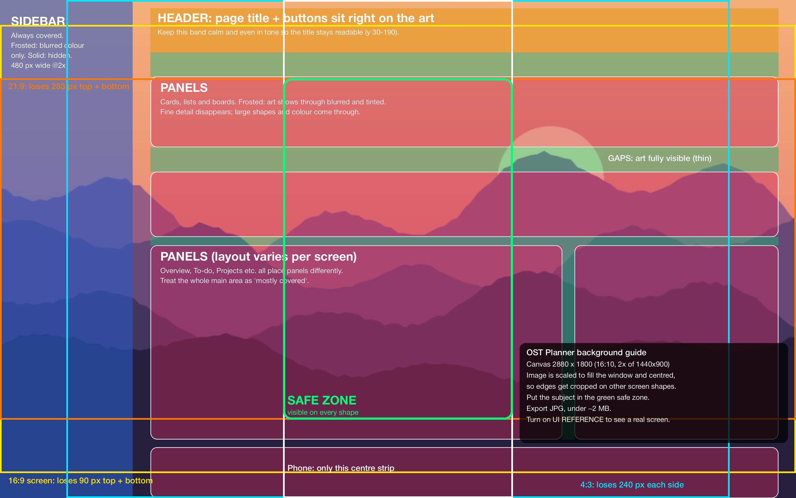

# OST Planner

Self-hosted project and time-management dashboard. Built one screen at a time.

## What you need

- **Docker**: [Docker Desktop](https://www.docker.com/products/docker-desktop/) on Mac or Windows (open it once so it's running), or Docker Engine on Linux.
- **git**: already on most Macs (run `git --version` in Terminal; if it isn't there, macOS offers to install it). On Windows, install [Git for Windows](https://git-scm.com/download/win).

## Install

In Terminal, go to the folder where you want the app (for example Documents) and run:

```sh
cd ~/Documents
git clone https://github.com/drawnesteban/ost-planner.git
cd ost-planner
docker compose up -d --build
```

Open **http://localhost:1820**. On first launch it asks for a library folder name and what to start with: the sample projects, an empty library, a backup, or what this browser saved in an older version.

## Update

From inside the app's folder:

```sh
cd ~/Documents/ost-planner
git pull
docker compose up -d --build
```

Your projects are safe. They live in `data/`, which git never touches, and so does your `.env`.

## Already running it from a zip?

Switch to the git copy once, keeping your data:

```sh
cd ~/Documents/ost-planner && docker compose down
cd .. && mv ost-planner ost-planner-old
git clone https://github.com/drawnesteban/ost-planner.git
mv ost-planner-old/data ost-planner/
cp ost-planner-old/.env ost-planner/ 2>/dev/null
cd ost-planner && docker compose up -d --build
```

Check http://localhost:1820 shows your projects, then delete `ost-planner-old`.

## Everyday commands

Run these from inside the app's folder.

- Stop: `docker compose down`
- Start again: `docker compose up -d`
- Port 1820 already taken: change `"1820:1820"` in `docker-compose.yml` to, say, `"8090:1820"`, run `docker compose up -d`, and open http://localhost:8090. (This edits a tracked file, so `git pull` may complain; run `git stash`, `git pull`, `git stash pop`.)
- Open from another device on your network: `http://<this-computer's-IP>:1820`
- `docker: command not found` or "Cannot connect to the Docker daemon": Docker Desktop isn't running. Open it and try again.

## Where your data lives

Everything (projects, contacts, to-dos, settings, uploaded images) is saved as files in the library folder:

- `data/<library name>/state/*.json` the data
- `data/<library name>/files/` uploaded images (named by content, so duplicates are stored once)
- `data/<library name>/backups/` automatic copy made before a whole-library restore

By default `data/` sits next to `docker-compose.yml`. Docker can only reach folders that are shared with it, so the location on your computer is set in `.env` (`OST_DATA_DIR=/full/path`), not inside the app. Change it, then `docker compose up -d`.

## Backups and moving to another computer

Dashboard settings (click the logo and name in the sidebar), Storage and backups:

- Back up everything: a .zip of the whole library.
- Back up project: a .zip of one project with its to-do cards, gallery files and images, and contacts from its client organization.
- Restore from a backup: a whole-library backup replaces the library (the current one is saved to `backups/` first). A project backup is added; if the same project already exists you choose Replace or Add as a copy.

On a new computer: follow Install above, then pick Restore from a backup on the setup screen. Copying the whole `data/` folder into the new install also works.

## Background image

Dashboard settings, Background: upload an image to fill the whole window behind every screen. Panels can be Frosted (see-through and blurred) or Solid, and Dim image darkens or lightens it so text stays readable. It works with Light, Dark and Match system. The image is resized to 2880 px and saved in the library, so backups include it.

To design one, use the template [`docs/ost-background-guide.psd`](docs/ost-background-guide.psd) (2880 × 1800). Its layer groups:

- YOUR ARTWORK: replace this layer with your image.
- UI REFERENCE: a real Overview screen at 2×, hidden by default.
- UI AREAS: the sidebar (always covered), the header band where the page title sits on the art, panels (blurred when Frosted), and the gaps where the art stays sharp.
- CROP GUIDES: the image fills the window and is centred, so edges are cropped on other screen shapes (16:9, 4:3, 21:9, phone). Keep the subject in the green safe zone.

Export a JPG under about 2 MB. Preview of the guide:



## Build status

| Step | Screen | State |
|------|--------|-------|
| 1 | Landing page (overview + navigation) | Built, placeholder data |
| 2 | Projects: Active / Not active groups, Squares or Rows layout, add/remove, Customize to drag, rename, change image, activate | Built |
| 2b | Project detail page (`#project/<id>`): tasks, to-do board, gallery, description and facts | Layout built, placeholder content, read-only |
| 3 | Personal works (same screen as Projects, for personal work) | Built |
| 4 | Tasks dashboard: all project + personal tasks, filters, counts, open tasks per project | Built, read-only placeholder tasks |
| 5 | To-do: one board with every project's to-do cards plus General ones; filter, add, drag, comments, hide/clear Done | Built |
| 6 | Timeline: project bars from start to due date, progress, milestones, today line; calendar below (mini month + agenda, Month and Year views) | Built, read-only |
| 7 | Contacts: searchable list (by name or organization), detail card with call/message/email, add/edit/delete with photo, linked projects | Built |
| 8 | Progress gallery: upload images per project, filter by project and kind, group by month or project; also on project pages and the Overview. Review viewer: versions (upload revision, markup copy), pen/arrow/box/circle/pin/eraser, colors, undo/redo, side-by-side compare, notes per version | Built |
| 9 | Appearance: Light / Dark / Match system, accent color and an optional background image (Frosted or Solid panels, dim), in Dashboard settings (click the logo and name in the sidebar) | Built |
| 11 | Editing: Quick add menu (task, to-do card, milestone, project, personal work, contact, images); tasks add/edit/check off/delete on project pages, Tasks and Overview; start/due dates, progress and milestones from Timeline bars, milestones and project pages; Overview uses real tasks and milestones | Built |
| 12 | Delete button with Undo on task rows; drag Timeline bars (move), their ends (start or due) and milestones; Edit details (name, client, description, amount, invoice PDF or image upload); sidebar Search (press /) across projects, contacts, tasks, milestones, to-do cards and gallery | Built |
| 10 | Backend: Node server (no packages), first-launch library setup, saving to disk, image files, backup and restore per project or whole library | Built |

## Layout

- `server/server.js` web server and API (Node 22, no npm packages); `server/zip.js` backup zips
- `public/js/boot.js` first-launch setup screen; `public/js/store.js` saving to the server
- `.env.example` settings template (copy to `.env`); `.gitignore` keeps `data/` and `.env` out of git
- `public/index.html` page shell (sidebar + header)
- `public/js/data.js` placeholder data
- `public/js/app.js` rendering and hash routing (`#overview`, `#projects`, ...)
- `public/css/app.css` styles
- `public/img/projects/` placeholder project cover images
- `public/fonts/` Helvetica Neue (from the project files)
- `docs/` background image template (PSD) and its preview

## Testing notes

- All browsers and devices that open the page share the same library.
- To start over: stop the container, delete `data/ost-config.json` (and the library folder if you don't want it), start again.
- The browser-only data from earlier versions is left in the browser after it's brought in; nothing reads it anymore.
- Images deleted in the app stay in `files/` (no cleanup yet). Backups only include images still in use.
